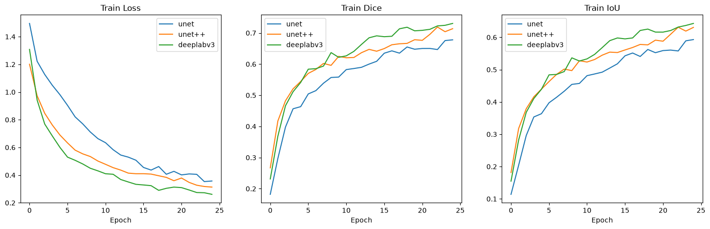
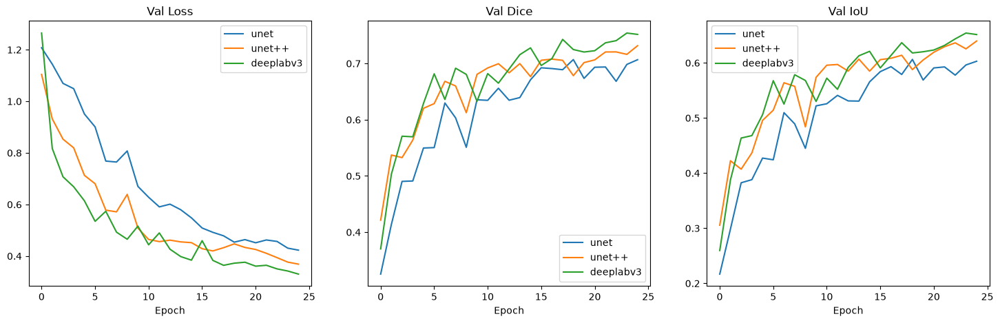
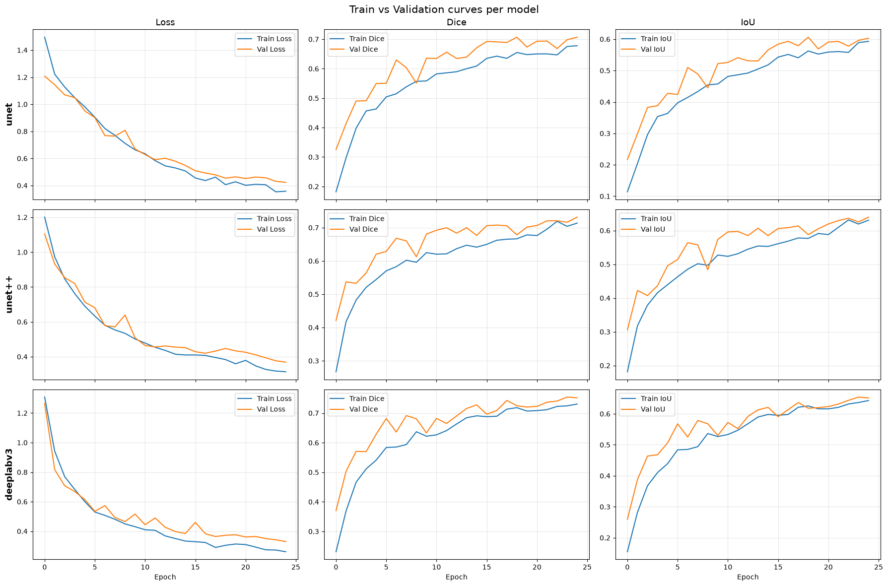
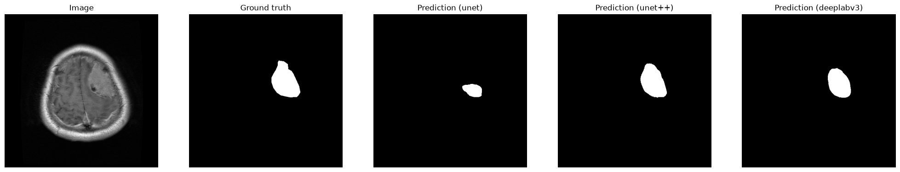
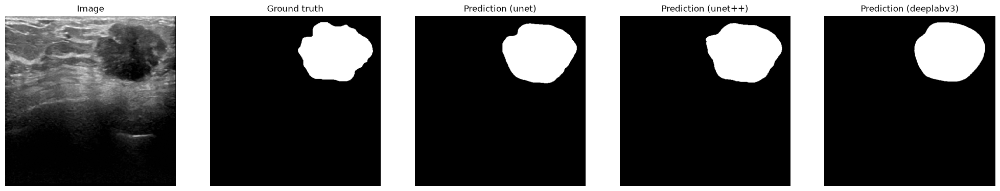
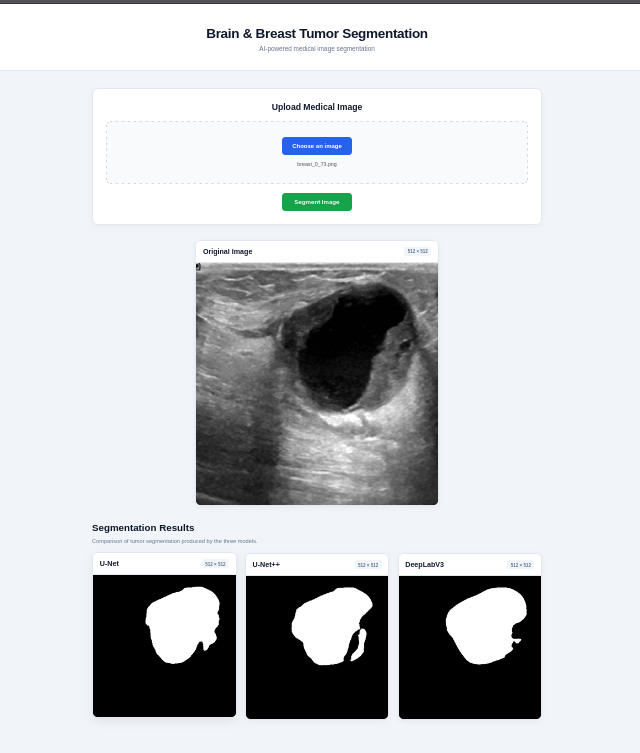

# Automated Brain & Breast Tumor Segmentation via Deep Learning

[](https://mouaad-erg.duckdns.org/tumor-segment/)
[]([suspicious link removed])
[]([suspicious link removed])
[]([suspicious link removed])
[]([suspicious link removed])

An end-to-end deep learning framework and web application for automated tumor detection and boundary segmentation in **Brain Magnetic Resonance Imaging (MRI)** and **Breast Ultrasound Scans**. The system leverages modern encoder-decoder neural architectures (**U-Net**, **U-Net++**, and **DeepLabV3**) backed by a pretrained **ResNet34** feature extractor.

---

## 🚀 Section 1: Project Objective, Technologies & Quick Start

### 🎯 Project Objective
Manual delineation of brain and breast tumor boundaries from medical imaging scans is time-consuming, subjective, and prone to intra-observer variability. This project delivers an automated, high-precision segmentation pipeline designed to:
- **Delineate Tumor Boundaries**: Isolate pathological lesions from surrounding healthy tissue in Brain MRI scans and Breast Ultrasound images.
- **Compare Architectures**: Benchmark modern segmentation heads (**U-Net**, **U-Net++**, **DeepLabV3**) on medical imaging datasets.
- **Full-Stack Deployment**: Provide a containerized web interface allowing clinicians and researchers to upload scans and view predicted segmentation masks in real time.

### 🛠️ Technologies Used

| Category | Technologies & Libraries |
| :--- | :--- |
| **Deep Learning Framework** | PyTorch, PyTorch Lightning, Torchvision |
| **Segmentation Architectures** | U-Net, U-Net++, DeepLabV3 (ResNet34 Backbone via `segmentation-models-pytorch`) |
| **Data Processing & Augmentations** | Albumentations, OpenCV, NumPy, SciPy, Scikit-Learn |
| **Data Visualization & Metrics** | Matplotlib, Seaborn, Pandas |
| **Backend Service** | FastAPI, Uvicorn, Python 3.10+ |
| **Frontend Application** | React.js, Tailwind CSS, Axios |
| **Containerization & Deployment** | Docker, Docker Compose, Nginx, DuckDNS |

---

### 🏁 Quick Start Guide

#### Prerequisites
- **Git**
- **Docker & Docker Compose** (Recommended for full-stack launch)
- **Python 3.10+** and **Node.js 18+** (For manual setup)

#### Method 1: Running with Docker Compose (Recommended)

1. **Clone the Repository**:
   ```bash
   git clone [suspicious link removed]
   cd brain-breast-tumor-segmentation-dl
   ```

2. **Launch Services**:
   ```bash
   docker-compose up --build
   ```

3. **Access Applications**:
   - **Frontend App**: `http://localhost:3000`
   - **Backend API Docs**: `http://localhost:8000/docs`

#### Method 2: Manual Local Setup

1. **Machine Learning Pipeline (`ml/`)**:
   ```bash
   cd ml
   python -m venv venv
   source venv/bin/activate  # On Windows: venv\Scripts\activate
   pip install -r requirements.txt
   python [lien suspect supprimé] --model unetplusplus --backbone resnet34 --epochs 50
   ```

2. **FastAPI Backend (`backend/`)**:
   ```bash
   cd ../backend
   pip install -r requirements.txt
   uvicorn app.main:app --host 0.0.0.0 --port 8000 --reload
   ```

3. **React Frontend (`frontend/`)**:
   ```bash
   cd ../frontend
   npm install
   npm start
   ```

---

## 📊 Section 2: Model Evaluation & Performance Plots

### 📈 Evaluation Metrics Explanation
To evaluate model performance objectively across unbalanced medical image datasets, the following quantitative metrics were calculated:

- **Dice Similarity Coefficient (DSC / F1-score)**: Measures spatial overlap between ground truth mask (\\(A\\)) and model prediction (\\(B\\)):
  \\[\text{Dice} = \frac{2 |A \cap B|}{|A| + |B|}\\]
- **Precision**: Proportion of correctly predicted tumor pixels relative to all pixels flagged as tumor by the model.
- **Recall (Sensitivity)**: Proportion of true tumor pixels correctly identified by the network.
- **Pixel Accuracy**: Percentage of correctly classified pixels across the total image area.

---

### 📉 Performance & Comparative Visualizations

#### 1. Training & Validation Curves
The convergence behavior across epochs shows smooth loss reduction and steady Dice score improvements for both training and validation sets, confirming effective learning without overfitting.




#### 2. Model Architecture Benchmarking
Comparing **U-Net**, **U-Net++**, and **DeepLabV3** (all using a **ResNet34** backbone):
- **U-Net++** achieves the highest Dice score and boundary accuracy due to nested dense skip pathways.
- **DeepLabV3** captures multiscale contextual features effectively using Atrous Spatial Pyramid Pooling (ASPP).



#### 3. Qualitative Segmentation Results
Comparison of raw medical input scans, true expert annotations (Ground Truth), and model-generated tumor boundary masks for both Brain MRI and Breast Ultrasound samples.




---

## 🌐 Section 3: Deployed Web Interface & Live Demo

### 🔗 Live Deployment
The application is deployed live and publicly accessible:

👉 **[Access Deployed Web App](https://mouaad-erg.duckdns.org/tumor-segment/)**  
`https://mouaad-erg.duckdns.org/tumor-segment/`

---

### 🖥️ Frontend User Interface

The React-based web interface enables seamless upload of Brain MRI and Breast Ultrasound images, triggering real-time inference via the FastAPI backend and rendering predicted segmentation masks overlaid onto the medical scans.



---

## 📁 Section 4: Repository Directory Architecture

```
brain-breast-tumor-segmentation-dl/
├── ml/                         # Core machine learning & deep learning pipeline
│   ├── data/                   # Data directory (raw datasets, preprocessing scripts, train/val splits)
│   ├── [lien suspect supprimé]              # PyTorch Dataset class for loading MRI & Ultrasound images and masks
│   ├── [lien suspect supprimé]           # Image preprocessing and Albumentations data augmentation pipelines
│   ├── models/                 # Model definitions (U-Net, U-Net++, DeepLabV3 with ResNet34 backbone)
│   ├── [lien suspect supprimé]               # Segmentation loss functions (Dice Loss, Focal Loss, BCE + Dice Loss)
│   ├── [lien suspect supprimé]                # Main PyTorch training loop with checkpointing and validation
│   └── [lien suspect supprimé]             # Evaluation script calculating Dice, Precision, Recall, and Accuracy
├── notebooks/                  # Interactive Jupyter notebooks for research and visualization
│   ├── 01_eda.ipynb            # Exploratory Data Analysis (scan intensity distributions, mask stats)
│   ├── 02_training.ipynb       # Interactive model training and hyperparameter experimentation
│   └── 03_evaluation_plots.ipynb # Plotting performance curves, comparison charts, and mask overlays
├── backend/                    # FastAPI REST API backend service
│   ├── app/                    # Application source code
│   │   ├── [lien suspect supprimé]             # FastAPI entry point, middleware, CORS, and endpoint definitions
│   │   ├── [lien suspect supprimé]          # Model inference wrapper for processing uploaded user scans
│   │   └── [lien suspect supprimé]            # Helper utilities for image conversion and tensor formatting
│   ├── Dockerfile              # Docker container configuration for backend service
│   └── requirements.txt        # Backend dependencies (FastAPI, PyTorch, OpenCV, Uvicorn)
├── frontend/                   # React user interface web application
│   ├── src/                    # Frontend React source code
│   │   ├── components/         # Reusable UI components
│   │   │   ├── ImageUploader.js # Drag-and-drop file uploader for Brain MRI & Ultrasound scans
│   │   │   ├── MaskViewer.js   # Side-by-side & overlay viewer for predicted segmentation masks
│   │   │   └── MetricsDisplay.js # Real-time display of segmentation confidence scores & metrics
│   │   ├── App.js              # Main application container and component routing
│   │   └── index.js            # React application DOM entry point
│   ├── public/                 # Static web assets and HTML index template
│   ├── Dockerfile              # Docker container build script for React frontend
│   └── package.json            # Node.js project configuration and frontend dependencies
├── images/                     # Project screenshots, training plots, and evaluation figures
│   ├── tumor-segment.png       # Screenshot of the deployed web user interface
│   ├── loss_curve.png          # Plot showing training vs validation loss across epochs
│   ├── model_comparison.png    # Bar chart comparing Dice scores across architectures
│   └── segmentation_results.png # Visual comparison of predicted tumor masks vs ground truth
├── docker-compose.yml          # Multi-container Docker orchestration configuration
├── .gitignore                  # Git exclusions (checkpoints, dataset caches, virtualenvs)
└── [lien suspect supprimé]                   # Primary project documentation and user guide
```

---
*Developed by Mouaad Errougbani — Deep Learning for Healthcare & Medical Computer Vision.*
